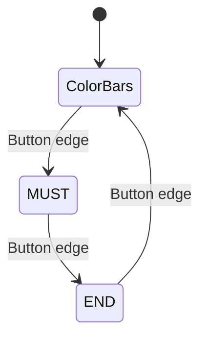

# VGA Display State Machine

A Verilog display controller switches between color bars, MUST lettering, and an END screen. The project combines a three-state controller, coordinate-based rendering, and RGB565 VGA output. 三状态 VGA 显示控制项目。

| Path | Role |
| --- | --- |
| [rtl/top_vga_controller.v](rtl/top_vga_controller.v) | Button-edge handling and display-state transitions |
| [rtl/vga_timing.v](rtl/vga_timing.v) | Raster timing and active video coordinates |
| [rtl/vga_color_bar.v](rtl/vga_color_bar.v) | Color-bar pixels |
| [rtl/vga_must.v](rtl/vga_must.v), [rtl/vga_end.v](rtl/vga_end.v) | Letter rendering |
| [sim](sim) | Board wrapper and C++/OpenGL desktop simulator |
| [tb/tb_top_vga_controller.v](tb/tb_top_vga_controller.v) | Original controller stimulus |



## Component simulation

With Icarus Verilog installed:

```bash
mkdir -p build
iverilog -g2012 -s tb_top_vga_controller -o build/controller.vvp rtl/top_vga_controller.v rtl/vga_color_bar.v rtl/vga_must.v rtl/vga_end.v tb/tb_top_vga_controller.v
vvp -n build/controller.vvp
```

The original testbench supplies reset and button pulses; it does not contain output assertions or a waveform dump.

## Desktop simulator build

Requires Bash, Verilator, a C++ compiler, Make, OpenGL/GLUT development libraries, and a graphical desktop for display. Typical Linux library packages are `freeglut3-dev` and `libglu1-mesa-dev`.

```bash
bash scripts/run_simulation.sh --build-only
bash scripts/run_simulation.sh
```

The source maps `a` to reset and `s` to the screen-selection button. Full desktop execution remains to be checked: the original `clk_divider` has no reset/initial value, and the C++ viewer's raster assumptions need to be matched against the timing module. The repository does not include board constraints or hardware timing reports.


[Full project portfolio](https://github.com/chengmiao2005/FPGAfinalproject/blob/main/docs/PORTFOLIO.md) · [Original-to-current file map](docs/FILE_MAP.md)

[Validation record](docs/VALIDATION.md)
